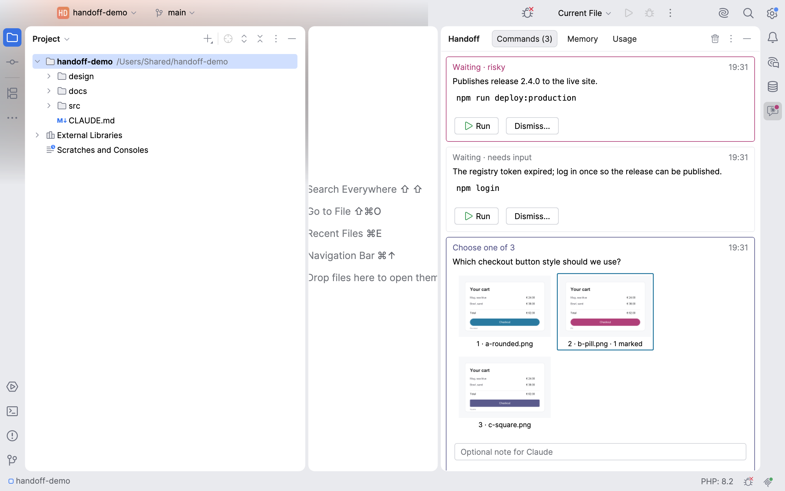

# Handoff for Claude Code


Plugin ID `app.heckit.ide.aihandoff` · Vendor heck\it ([heckit.app](https://heckit.app)) · Source: https://github.com/phse/ai-handoff · Support: [GitHub Sponsors](https://github.com/sponsors/phse) or [Ko-fi](https://ko-fi.com/phse_de) · Feedback and feature requests: [plugin-ai-handoff@heckit.app](mailto:plugin-ai-handoff@heckit.app)



A plugin for JetBrains IDEs (PhpStorm, IntelliJ IDEA, … 2026.1 and later): the place where Claude Code hands work
over to you, and you hand the result back.

Some steps an AI agent should not run on its own: deploys, logins, releases, uploads. Instead of copying a command out
of the chat, running it somewhere and pasting the output back, Claude proposes it through the IDE's MCP server.

- **Proposed commands** appear as cards in the **Handoff** tool window: command, reason and working directory.
  Risky ones (production, publishing, deleting) get a highlighted border.
- **Run** starts the command in the Run tool window, in a login shell (`$SHELL -l -i -c`), so your `PATH`, `JAVA_HOME`
  and aliases are there. The command can be edited before running.
- **Dismiss…** drops it, optionally with a note for Claude (e.g. "I'll do that tomorrow").
- **Result back to Claude**: exit code and the last 60 lines of output. After the run the card turns green or red.
- **One changelist per task**: Claude can open the changelist "Claude: <task>" before it edits files. Everything
  changed until the task ends lands there (new files are added to Git), so you review and commit the task on its own.
- **Review with line notes**: Claude asks you to review its changes. The card lists the changed files of the task and
  opens their diff. Hover a line in the diff (or, while a review is waiting, in the editor) and click the **+** next to its line number, or use **Add Note for
  Claude…** in the context menu of the diff or editor (select several lines for a range); the note shows as a gutter icon and grey text at the end of the line. **Approve**, or **Send Notes**: Claude
  gets each note with path, line and the line of code. Notes left without a review wait in a card until Claude
  fetches them. Notes are kept in memory only.
- **Command sequences**: several commands as one card (verify, tag, push, upload). **Run All** runs them one after
  another and stops at the first one that fails, **Run Step n** runs only the next one; each command can be edited.
  Claude gets exit code and output per step.
- **Claude is waiting** (optional, **Show When Claude Is Waiting** in the tool window's ⋮ menu): a card and a
  notification when a Claude Code session in the project is done or needs your input. Handoff creates
  `~/.claude/handoff/hook.sh` and adds it as a hook for Stop, Notification, UserPromptSubmit and SessionEnd in
  `~/.claude/settings.json` (backup `settings.json.bak-handoff`, existing hooks stay); switching it off removes them.
  The "done" card shows the start of the message formatted, opens the full message in an editor tab and has a field
  for the next prompt, which goes straight to that session (the Stop hook waits for it in the background, `asyncRewake`).
- **Update CLAUDE.md**: after an update, pick the Handoff instructions your CLAUDE.md files don't mention yet and send
  them to a waiting Claude Code session (or copy the prompt). The Usage tab lists each Handoff tool with its calls and
  whether CLAUDE.md mentions it.
- **Questions with options**: Claude asks one or more questions as a card (Back/Next), one answer or several
  (`multiSelect`) per question, each option with a short description, plus a field for an own answer.
- **Handoff Tools**: calls per tool; per tool a switch for the CLAUDE.md instruction (Claude edits the file on request)
  and one for the permission (`permissions.deny` in `~/.claude/settings.json`).
- **Notifications**: a system notification and a mark on the dock or taskbar icon when something is waiting while the
  IDE is in the background; a dot on the tool window icon and a count on the Commands tab.
- **Images to review or choose from**: Claude shows one image (approve or dismiss) or several variants (pick one),
  with an optional note. Hover a thumbnail to open it in the viewer or in an editor tab.
- **Viewer with marks**: page with ← →, zoom with + / − / 1 (actual size) / 0 (fit). The pen tool draws a frame; write
  a note right at the frame, move it by its label, resize it at the corners. Claude gets the frames in pixels of the
  original image.
- **Memory tab**: what Claude Code loads into every session – global and project `CLAUDE.md`, `@`-imports and the
  project's memory – as a tree with token estimates per file and per section. Warns about memories missing from
  `MEMORY.md`, index entries without a file and oversized files; lists files only referenced by path ("on demand") and
  similar paragraphs across files.
- **Usage tab**: tokens per day and per session for this project (today, 7 or 30 days), read from Claude Code's
  session logs. Optionally the plan limits (5-hour and weekly) with their reset times, see below.
- Nothing runs without your click.

## Tools

| Tool | Parameters | Returns |
|---|---|---|
| `handoff_propose_command` | `command` (string), `reason` (string, one sentence), `workingDirectory` (absolute or relative to the project root, empty = root), `risky` (boolean, default `false`) | an `id` at once; opens the tool window |
| `handoff_propose_sequence` | `commands` (list of strings, in order), `reason`, `workingDirectory`, `risky`, `interactive` | an `id` at once; one card, stops at the first failing command; `handoff_wait_for_result` returns exit code and output per step |
| `handoff_begin_task` | `title` (a few words) | makes the new changelist `Claude: <title>` the active one |
| `handoff_end_task` | – | the files changed in the task; makes the previous changelist active again, removes the task's changelist if empty |
| `handoff_request_review` | `summary` (one or two sentences) | an `id` at once; reviews the changelist of the current or last task, otherwise all local changes |
| `handoff_get_notes` | – | the open line notes (`path:line`, note, line of code) and removes them; `No open notes.` |
| `handoff_ask` | `questions` (list of `{question` (Markdown), `options` (list of `{label, description}`), `multiSelect}`), `title` (optional) | an `id` at once; one card, several questions with Back/Next, radio buttons or checkboxes and a field for an own answer per question |
| `handoff_show_images` | `paths` (image files, absolute or relative to the project root), `question` | an `id` at once; one image to approve, several to choose from |
| `handoff_wait_for_result` | `id`, `timeoutSeconds` (1–50, default 50; MCP clients abort longer calls) | exit code and last 60 output lines, the chosen image (or approval) with the note and marked areas, the review result (`approved` or `changes requested` with the line notes), the chosen options and own answer, the dismiss note, or `pending` after the timeout (call again to keep waiting) |

## Installation

From the JetBrains Marketplace: *Settings | Plugins | Marketplace*, search for "Handoff for Claude Code".

Then:

1. Enable the IDE's MCP server: *Settings | Tools | MCP Server*.
2. Connect Claude Code to it (same settings page, *Auto-Configure* for Claude Code), or reconnect with `/mcp`
   if it was connected before.
3. Tell Claude when to use it: **Copy CLAUDE.md Snippet** in the empty Commands tab copies a block for all tools into
   the clipboard; paste it into your `CLAUDE.md`.

The built-in guide (**Guide** in the tool window's ⋮ menu, source: `src/main/resources/guide/guide.md`) holds the setup, one
prompt per feature and *Version history* (at the end). After an update the Commands tab shows the first line under the new version's
heading once. New features: add a section with its prompt, extend the snippet between the `snippet` markers and add a
version heading under *Version history*.

### Plan limits (optional)

Claude Code passes the 5-hour and weekly plan limits only to a status line script. **Show Plan Limits…** in the Usage
tab creates `~/.claude/handoff/statusline.sh` and sets it as the status line in `~/.claude/settings.json` (backup:
`settings.json.bak-handoff`). The script stores Claude Code's status line data in `~/.claude/handoff/statusline.json`
for the IDE and prints `5h 23% · week 41%`; an existing status line command keeps working, the script calls it. Only Pro
and Max plans report limits.

## Build and run

Gradle needs JDK 17 or later.

```
./gradlew runIde        # start a sandbox IDE with the plugin
./gradlew buildPlugin   # build/distributions/ai-handoff-<version>.zip
```

Verify against the local IDE, the oldest supported version (`verifyOldestVersion`) and the newest EAP
(`verifyNewestVersion`):

```
./gradlew verifyPlugin
```

By default Gradle downloads PhpStorm `platformVersion` (from `gradle.properties`) as the target platform. With an
installed IDE it's faster: create `local.properties` (not checked in) containing e.g.

```
platformLocalPath=/Applications/PhpStorm.app
```

The sandbox runs its MCP server on a fixed port (`-Didea.mcp.server.force.port`, default `64499`, override with
`-PsandboxMcpPort=…`), so Claude Code can test against it next to your main IDE:

```
claude mcp add --transport http -s local phpstorm-sandbox http://127.0.0.1:64499/stream
```

While the sandbox runs, `./gradlew prepareSandbox_runIde -PdevBuild=$(date +%s)` reloads the plugin there without a restart
(the sandbox only reloads a plugin whose version changed; `devBuild` appends `-dev.<n>`). The reload happens once the sandbox
window gets focus.

## Publishing (JetBrains Marketplace)

The Marketplace description lives in `src/main/resources/META-INF/plugin.xml`, the change notes in `build.gradle.kts`,
the icon in `META-INF/pluginIcon.svg` (light theme) and `pluginIcon_dark.svg` (dark theme). The IDE and the Marketplace
read the icon straight from the ZIP. After changing the icon, regenerate the preview `marketplace/plugin-icon.png` at
the top of this README:

```
T=$(mktemp -d)
rsvg-convert -w 120 src/main/resources/META-INF/pluginIcon.svg -o $T/l.png
rsvg-convert -w 120 src/main/resources/META-INF/pluginIcon_dark.svg -o $T/d.png
magick -size 180x160 xc:'#F7F8FA' $T/l.png -gravity center -composite $T/L.png
magick -size 180x160 xc:'#2B2D30' $T/d.png -gravity center -composite $T/D.png
magick $T/L.png $T/D.png +append marketplace/plugin-icon.png
```

1. Bump the version in `gradle.properties`, add change notes.
2. `./gradlew clean buildPlugin verifyPlugin`
3. `./gradlew publishPlugin` with a token from https://plugins.jetbrains.com/author/me/tokens, either as
   `PUBLISH_TOKEN=…` or globally in `~/.gradle/gradle.properties` as `jetbrainsMarketplaceToken=…`.
4. Tag the commit (`git tag v<version>`) and push.
5. Update the custom page by hand (plugin page, *Custom Pages* tab, Markdown): `marketplace/custom-pages/user-guide.md`.
   `publishPlugin` doesn't upload custom pages. It is the built-in guide (`src/main/resources/guide/guide.md`) without
   title, contents and version history - copy changes from the guide over before each release.

## Regenerating the screenshots

```
./gradlew runIde -Pscreenshots=marketplace/screenshots
```

Copies `marketplace/demo-project` to `/Users/Shared/handoff-demo` (no personal path in the images), writes demo memory and
session logs for it under `~/.claude/projects/-Users-Shared-handoff-demo/` and paints the IDE frame into PNGs (no screen
recording permission needed). The helper in `src/screenshot` is only compiled with `-Pscreenshots`; never publish such a build.
The Marketplace takes screenshots only by hand (*Edit Plugin | Media*).

## How it works

The plugin registers an `mcpServer.mcpToolset` with the IDE's bundled MCP server (plugin `com.intellij.mcpServer`), so
any connected MCP client sees the tools. Proposals live in a project service; `handoff_propose_command` returns
right away, `handoff_wait_for_result` suspends on the proposal until it is run or dismissed (or the timeout passes), so
a long deploy never blocks a single MCP call. Commands run as a `KillableColoredProcessHandler` in the Run tool window.

The Memory tab reads `~/.claude/CLAUDE.md`, every `CLAUDE.md`, `.claude/CLAUDE.md` and `CLAUDE.local.md` from the home
folder down to the project, and `~/.claude/projects/<project path with - for every non-alphanumeric character>/memory/`.
Tokens are estimated as characters / 4. The Usage tab reads the `.jsonl` session logs in that project folder; each
response is counted once (by message id).

## License

Apache License 2.0, see [LICENSE](LICENSE) and [NOTICE](NOTICE). "Handoff", "heck\it" and the logo are not covered by
the license.

Not affiliated with or endorsed by Anthropic. "Claude" and "Claude Code" are trademarks of Anthropic, PBC.
